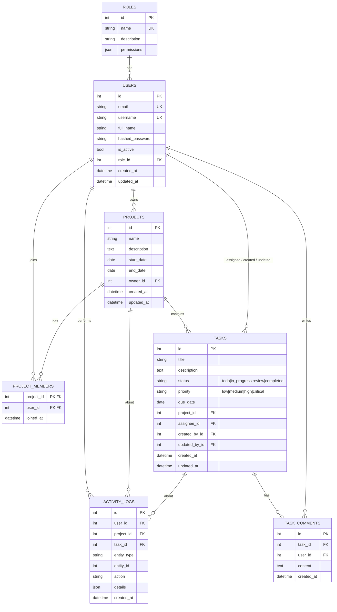

# Database Schema (ER Diagram)

Render this with any Mermaid viewer (GitHub renders it automatically).

**Delete behaviour:** deleting a project cascades to its members, tasks and comments;
activity logs are kept (their `project_id` / `task_id` become NULL), so history survives.
Users are deactivated, never deleted.
